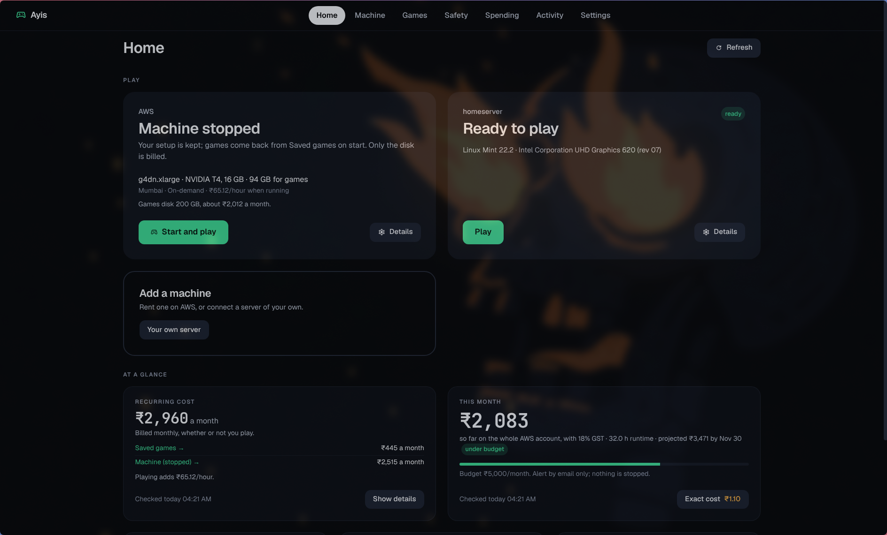
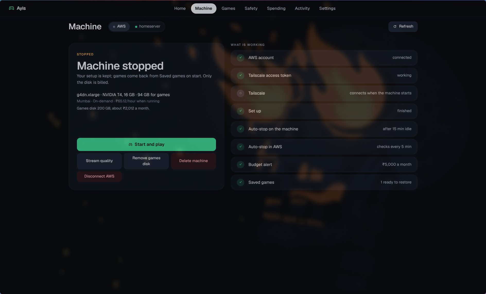
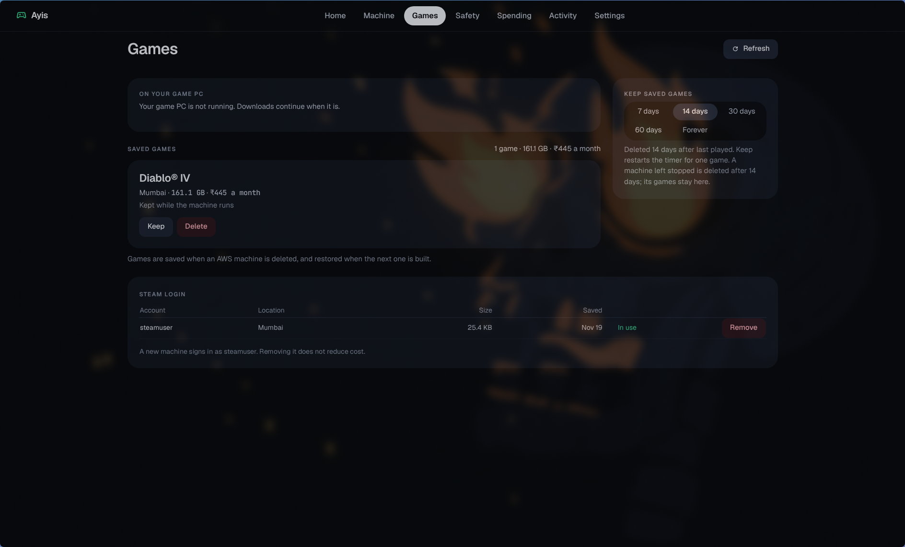
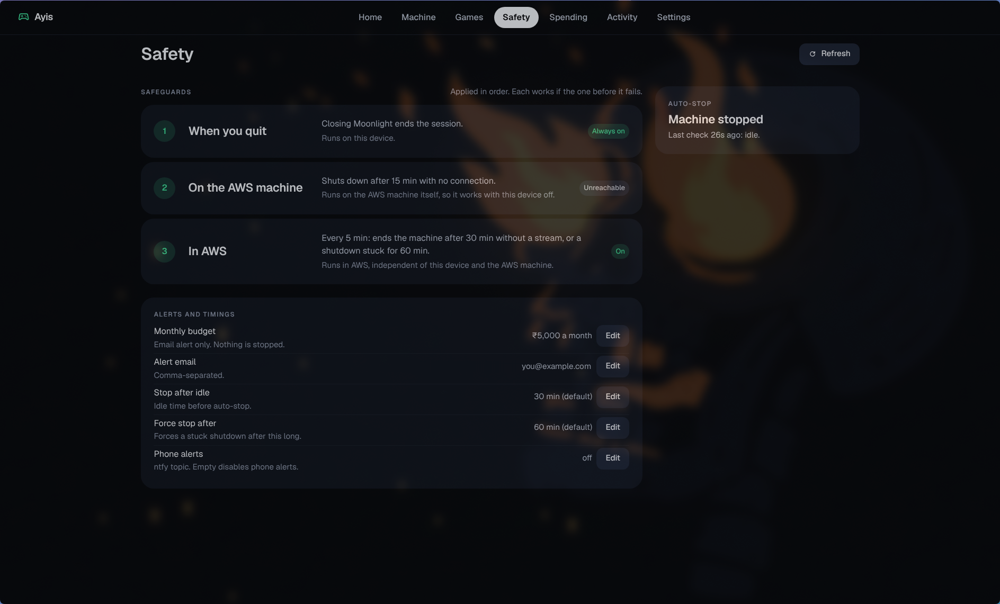
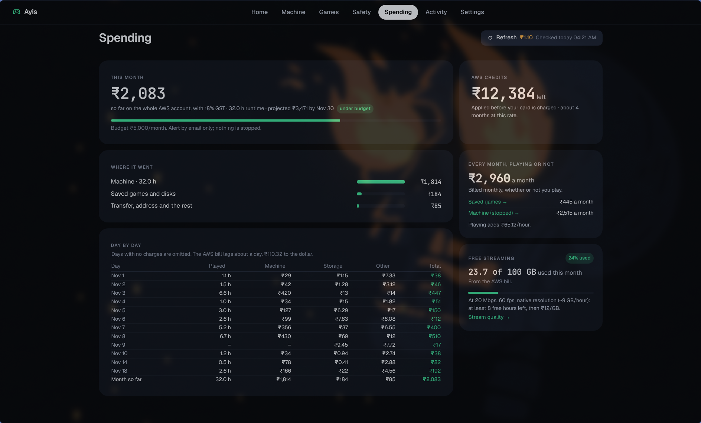

# Ayis

**All Yours, Instantly Streamed.**

Stream games to your laptop from a GPU machine rented on AWS, or from a Linux server of your own.
A desktop app for Linux, built on [Sunshine](https://github.com/LizardByte/Sunshine),
[Moonlight](https://github.com/moonlight-stream) and [Tailscale](https://tailscale.com).

> **Beta.** An AWS machine bills by the hour while it runs. No warranty - see [LICENSE](LICENSE)
> and [docs/cost.md](docs/cost.md).

<table>
  <tr>
    <td></td>
    <td></td>
  </tr>
  <tr>
    <td align="center"><b>Machine</b> - one button to start, and a checklist of what is working</td>
    <td align="center"><b>Games</b> - games are saved when a machine is deleted and restored on the next</td>
  </tr>
  <tr>
    <td></td>
    <td></td>
  </tr>
  <tr>
    <td align="center"><b>Safety</b> - three layers of auto-stop, so a forgotten machine does not bill all night</td>
    <td align="center"><b>Spending</b> - the AWS bill day by day, and what you pay even when not playing</td>
  </tr>
</table>

## Install

Download from [Releases](https://github.com/jebin2/ayis/releases):

| File | For | Install |
|---|---|---|
| `.pacman` | Arch, CachyOS, Omarchy | `sudo pacman -U <file>` |
| `.deb` | Debian, Ubuntu, Mint | `sudo dpkg -i <file>` |
| `.tar.gz` | Any Linux | Extract and run `ayis` |
| `.AppImage` | Any Linux with FUSE 2 | Make executable and run |
| `.dmg` / `-portable.exe` | macOS, Windows | **Untested first try**, unsigned - see the release notes |

Linux is where Ayis is built and used. On macOS and Windows the `ayis` program has been through a
full build, play and delete, but the desktop app around it has not yet been used by a person.

## What you need

- A [Tailscale](https://tailscale.com) account
- **Your own server:** a Linux machine you can reach over SSH
- **AWS:** an account on a paid plan, and a GPU quota

> **A new AWS account can run zero GPU machines.** You have to ask AWS to raise the limit, and
> the first answer is usually no - reopening the same case with a use case gets it approved, but
> it can take a few days. Start early: [docs/quota-request.md](docs/quota-request.md), or
> `ayis quota request ondemand`. A server of your own needs none of this.

The app installs anything missing on this computer when you add a machine.

## Use

1. Open the app and choose **Add a machine** - AWS, or your own server.
2. Press **Play**. Moonlight opens with the machine's desktop.
3. Close Moonlight to end the session.

An AWS machine keeps running after a session until auto-stop ends it or you press **Delete**.
**Hard limits** switch it off even while you play: 60 hours a month, 6 hours a session, and the
monthly budget - each with a warning first and a button on the Safety page to extend it
([docs/cost-guards.md](docs/cost-guards.md#hard-limits)).
Your games are saved to S3 when it is deleted and restored on the next build. Saved games are a
recurring monthly cost, by size, for as long as they are kept - 14 days after the last machine by
default, adjustable on the Games page.

## From source

    git clone https://github.com/jebin2/ayis.git
    cd ayis/app && npm install && npm start

The app runs `ayis`, a Go program built from this repository (`npm start` builds it first; Go is needed). To use it directly: `go build -o ayis ./cmd/ayis`, then `./ayis help` - or see [docs/commands.md](docs/commands.md).

## Documentation

[Cost](docs/cost.md) · [AWS setup](docs/aws-account-setup.md) · [Streaming](docs/streaming.md) ·
[Troubleshooting](docs/troubleshooting.md) · [Architecture](docs/architecture.md) ·
[All commands](docs/commands.md)
